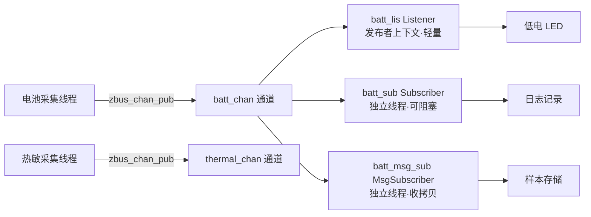
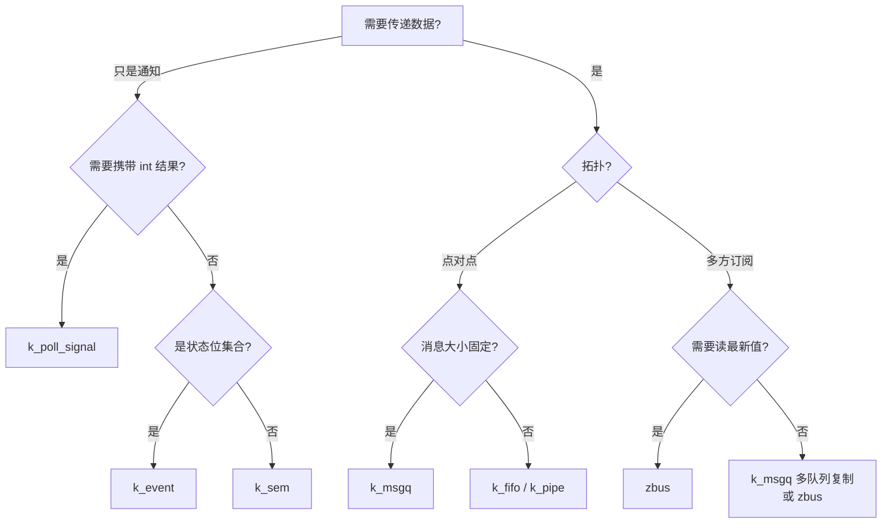

:::note[阅读提示]
本章节涵盖 Zephyr RTOS 的通用技术概念。芯海 EC 平台的具体应用请参考 **开发指南** 与 **移植指南**。
:::

:::info[学习目标]
通过本章学习，你将掌握：

- `k_timeout_t` 超时语义族：相对超时、绝对超时、不等待与永久等待的正确用法
- 用 `k_poll` 在单线程中同时等待多个事件源，替代"一个事件源一个线程"的栈开销
- 用 `k_poll_signal` 实现轻量级异步通知
- 用 `zbus` 构建发布/订阅解耦架构：通道定义、三种观察者、发布与读取
- 在 `k_msgq` / `k_fifo` / `k_poll` / `zbus` / `k_event` 之间做出正确的选型决策
:::

## 概述

EC 固件的典型控制线程很少只等待单一事件源：一个电源管理线程可能要同时响应主机命令到达、电池数据就绪、按键中断、定时器到期。如果为每个事件源单独建一个阻塞线程，线程栈开销会随事件源数量线性增长；如果在单线程里用带短超时的轮询循环硬等，又浪费 CPU。

Zephyr 3.7 提供了一组互补的异步原语解决这个问题：

- **`k_timeout`** —— 所有阻塞 API 共用的超时语义，含相对与绝对两种表达
- **`k_poll`** —— 单线程同时等待信号量、消息队列、FIFO、管道与信号的"就绪"状态
- **`zbus`** —— 发布/订阅消息总线，用通道（channel）解耦生产者与消费者

本章逐个拆解这三件套，最后给出一张跨机制选型决策表。所有示例均可在 `native_sim` 上免硬件运行。

## 1. k_timeout：Zephyr 的超时语义

### 1.1 k_timeout_t 与四种基本取值

Zephyr 几乎所有可能阻塞的内核 API（`k_sem_take`、`k_msgq_get`、`k_mutex_lock`、`k_poll`……）都接受一个 `k_timeout_t` 参数。它不是裸的毫秒整数，而是一个以系统 tick 为单位的结构体——直接把毫秒数塞进去是类型错误，必须通过宏构造：

| 宏 | 语义 | 典型场景 | ISR 中可用 |
|----|------|----------|-----------|
| `K_NO_WAIT` | 不等待，立即返回 | 轮询式取用；ISR 中取用资源 | ✅（阻塞 API 在 ISR 中唯一合法取值） |
| `K_MSEC(ms)` | 相对等待 ms 毫秒 | 常规等待 | ❌ |
| `K_SECONDS(s)` | 相对等待 s 秒 | 长等待 | ❌ |
| `K_FOREVER` | 永久等待 | 专职线程等待事件 | ❌ |
| `K_TIMEOUT_ABS_MS(ms)` | 等到系统启动后第 ms 毫秒（绝对截止时刻） | 周期任务防漂移、对齐截止时间 | ❌ |

:::warning[ISR 中的铁律]
ISR 上下文中调用可能阻塞的 API，**只能传 `K_NO_WAIT`**。传 `K_MSEC(...)` 或 `K_FOREVER` 会导致断言失败或不可预期的行为——ISR 没有"自己"这个可调度的线程可挂起。
:::

`K_NO_WAIT` 的本质是零值宏：`K_MSEC(0)` 与它行为等价，但可读性差、易被误读成"等 0 毫秒但仍然调度"，统一使用 `K_NO_WAIT`。

### 1.2 相对超时 vs 绝对超时

`K_MSEC()` 表达的是"从现在起再等多久"。这对周期性任务有一个隐患：如果任务体本身的执行耗时不确定，每次都以"醒来之后再加一个周期"计算下一时刻，误差会不断累积（漂移）：

```c
/* ✗ 漂移版本：每周期 = 任务执行耗时 + K_MSEC(1000)，实际周期 > 1000ms */
while (1) {
    sample_sensors();
    k_sleep(K_MSEC(1000));          /* 永远从"现在"起算 */
}
```

`K_TIMEOUT_ABS_MS()` 表达的是"等到系统运行时间的某个绝对时刻"。用它锚定周期栅格，任务耗时就不会叠加到周期里：

```c
/* ✓ 栅格版本：每周期恒为 1000ms，与任务耗时无关 */
#define PERIOD_MS 1000

static void grid_task(void)
{
    uint32_t next = k_uptime_get_32() + PERIOD_MS;

    while (1) {
        sample_sensors();           /* 无论耗时多少（<PERIOD_MS） */
        k_sleep(K_TIMEOUT_ABS_MS(next));
        next += PERIOD_MS;          /* 下一栅格点 */
    }
}
```

`K_TIMEOUT_ABS_MS` 自 Zephyr 3.3 引入，3.7 中所有接受 `k_timeout_t` 的 API 均可使用。

### 1.3 常见误用清单

:::danger[超时语义中不应该做的]
- **在 ISR 中传非 `K_NO_WAIT` 的超时**——阻塞语义在 ISR 中非法
- **把 `int` 毫秒值直接赋给 `k_timeout_t` 形参**——类型不匹配，编译器可能不报错但语义完全错误
- **用 `K_FOREVER` 等待外部事件且无看门狗兜底**——事件源一旦失效，线程永久挂死
- **假设超时精度优于 1 个 tick**——实际唤醒时刻按 `CONFIG_SYS_CLOCK_TICKS_PER_SEC` 的 tick 边界对齐
:::

:::success[超时语义中应该做的]
- 专职事件线程用 `K_FOREVER` 等待，配合事件源本身的生命周期管理
- 周期任务用 `K_TIMEOUT_ABS_MS` 锚定栅格，消除漂移
- 对外部输入驱动的等待，用有限超时 + 重试循环，超时后记录日志并降级
- 需要测量间隔时使用 `k_uptime_delta()` 而不是手工保存/相减
:::

## 2. k_poll：单线程等待多个事件源

### 2.1 解决什么问题

比较两种"等待三个事件源"的实现：

| 方案 | 线程数 | 栈开销 | 响应模型 |
|------|--------|--------|----------|
| 每源一线程 + `K_FOREVER` 阻塞 | 3 | 3 × 线程栈 | 每源独立响应，天然并发 |
| 单线程 + `k_poll` | 1 | 1 × 线程栈 | 集中处理，需检查是哪个源就绪 |

`k_poll` 的价值在于**只通知、不消费**：它告诉你"信号量可用 / FIFO 有数据 / 信号已触发"，但不会替你把信号量 take 掉或把消息取出来——你需要在就绪之后自己调用对应的 API。这个设计让多个等待者之间不会因为 poll 而互相抢走资源。

需要启用 `CONFIG_POLL`。

### 2.2 事件类型与状态

每个 `k_poll_event` 由「类型 + 对象」描述一个等待源：

| 事件类型 | 等待对象 | 就绪状态值 |
|----------|----------|-----------|
| `K_POLL_TYPE_SEM_AVAILABLE` | `struct k_sem` | `K_POLL_STATE_SEM_AVAILABLE` |
| `K_POLL_TYPE_FIFO_DATA_AVAILABLE` | `struct k_fifo` | `K_POLL_STATE_FIFO_DATA_AVAILABLE` |
| `K_POLL_TYPE_MSGQ_DATA_AVAILABLE` | `struct k_msgq` | `K_POLL_STATE_MSGQ_DATA_AVAILABLE` |
| `K_POLL_TYPE_PIPE_DATA_AVAILABLE` | `struct k_pipe` | `K_POLL_STATE_PIPE_DATA_AVAILABLE` |
| `K_POLL_TYPE_DATA_AVAILABLE` | `struct k_queue` | `K_POLL_STATE_DATA_AVAILABLE` |
| `K_POLL_TYPE_SIGNAL` | `struct k_poll_signal` | `K_POLL_STATE_SIGNALED` |

只有一个通知模式：`K_POLL_MODE_NOTIFY_ONLY`。

### 2.3 基本用法：一个线程等三个源

```c
#include <zephyr/kernel.h>
#include <zephyr/sys/printk.h>

#define CTRL_THREAD_STACK 2048
#define CTRL_THREAD_PRIO  7

static K_MSGQ_DEFINE(cmd_msgq, sizeof(uint32_t), 8, 4);   /* 命令队列 */
static struct k_sem sensor_sem;                            /* 传感器数据就绪 */
static struct k_poll_signal shutdown_sig;                  /* 关机请求 */

/* 静态初始化事件数组：一个线程同时等三个源 */
static struct k_poll_event events[3] = {
    K_POLL_EVENT_STATIC_INITIALIZER(K_POLL_TYPE_MSGQ_DATA_AVAILABLE,
                                    K_POLL_MODE_NOTIFY_ONLY, &cmd_msgq, 1),
    K_POLL_EVENT_STATIC_INITIALIZER(K_POLL_TYPE_SEM_AVAILABLE,
                                    K_POLL_MODE_NOTIFY_ONLY, &sensor_sem, 2),
    K_POLL_EVENT_STATIC_INITIALIZER(K_POLL_TYPE_SIGNAL,
                                    K_POLL_MODE_NOTIFY_ONLY, &shutdown_sig, 3),
};

static void control_thread(void)
{
    k_sem_init(&sensor_sem, 0, 1);
    k_poll_signal_init(&shutdown_sig);

    while (1) {
        int rc = k_poll(events, ARRAY_SIZE(events), K_FOREVER);

        if (rc == -EAGAIN) {
            continue;                 /* 超时：本例用 K_FOREVER 不会走到 */
        }

        for (int i = 0; i < ARRAY_SIZE(events); i++) {
            switch (events[i].state) {
            case K_POLL_STATE_MSGQ_DATA_AVAILABLE:
                uint32_t cmd;
                /* poll 只"通知"，消息仍要自己取 */
                if (k_msgq_get(&cmd_msgq, &cmd, K_NO_WAIT) == 0) {
                    printk("处理命令 0x%x\n", cmd);
                }
                break;

            case K_POLL_STATE_SEM_AVAILABLE:
                k_sem_take(&sensor_sem, K_NO_WAIT);
                printk("传感器数据就绪\n");
                break;

            case K_POLL_STATE_SIGNALED:
                int result;
                k_poll_signal_check(&shutdown_sig, NULL, &result);
                printk("收到关机请求（result=%d），退出\n", result);
                return;

            default:
                break;
            }

            /* ★ 关键：复用事件数组前必须把状态清回未就绪 */
            events[i].state = K_POLL_STATE_NOT_READY;
        }
    }
}

K_THREAD_DEFINE(control_tid, CTRL_THREAD_STACK, control_thread,
                NULL, NULL, NULL, CTRL_THREAD_PRIO, 0, 0);
```

三个要点（每一点都对应真实踩坑场景）：

1. **poll 之后必须自己消费**：`K_POLL_STATE_MSGQ_DATA_AVAILABLE` 不代表消息已经被你拿走，必须调用 `k_msgq_get`。如果另一个消费者抢先取走，`k_msgq_get(K_NO_WAIT)` 返回非 0，这不是错误，是正常的竞争结果。
2. **状态必须手动复位**：`events[i].state = K_POLL_STATE_NOT_READY` 不可省略，否则下一轮 `k_poll` 立即返回（状态仍是"就绪"）。
3. **tag 字段用于识别源**：初始化器的第四个参数（1/2/3）是任意用户标签，在日志中区分事件源很方便。

### 2.4 k_poll_signal：轻量异步通知

`k_poll_signal` 是专为 `k_poll` 设计的单值通知原语——不带数据、开销最小，适合"发生了某件事"这类布尔语义：

```c
static struct k_poll_signal fatal_sig;

void init_fatal_signal(void)
{
    k_poll_signal_init(&fatal_sig);
}

/* 任意上下文（含 ISR）触发 */
void report_fatal(int reason)
{
    /* 返回 0 = 通知成功；-EAGAIN = poller 恰好超时退出，结果仍已记录 */
    k_poll_signal_raise(&fatal_sig, reason);
}

/* 监控线程 */
void watch_fatal(void)
{
    unsigned int signaled;
    int result;

    k_poll_signal_check(&fatal_sig, &signaled, &result);
    if (signaled) {
        /* result 即 raise 时传入的 reason */
        log_panic_reason(result);
        k_poll_signal_reset(&fatal_sig);   /* 清除，准备下一轮 */
    }
}
```

| API | 签名 | 说明 |
|-----|------|------|
| `k_poll_signal_init` | `void (struct k_poll_signal *sig)` | 初始化，任何使用前必须调用 |
| `k_poll_signal_raise` | `int (struct k_poll_signal *sig, int result)` | 置位并唤醒 poller；返回 `-EAGAIN` 表示 poller 超时正在退出（结果仍被记录） |
| `k_poll_signal_check` | `void (struct k_poll_signal *sig, unsigned int *signaled, int *result)` | 非阻塞查询当前状态 |
| `k_poll_signal_reset` | `void (struct k_poll_signal *sig)` | 清除 signaled 标志，供下次 poll 使用 |

:::warning[不复位 = 立即返回]
`k_poll_signal_raise` 之后若不调用 `k_poll_signal_reset`，下一次 `k_poll` 会认为信号仍在，**立即返回**。在循环中复用信号对象时，reset 与 2.3 节的 state 复位同等重要。
:::

### 2.5 轮询循环模式与陷阱

:::danger[k_poll 中不应该做的]
- **在 ISR 中用阻塞超时调用 `k_poll`**——只能 `K_NO_WAIT`
- **忘记复位 `event.state` 与 `k_poll_signal_reset`**——下一轮假就绪
- **把 `k_poll` 的"通知"当作"消费"**——就绪后必须显式 `take`/`get`
- **用短超时 `k_poll` 空转代替阻塞**——那是轮询不是等待，白烧 CPU
:::

:::success[k_poll 中应该做的]
- 监控/调度型集中线程用 `K_FOREVER` + 多事件数组
- 需要兜底的场景用有限超时（如 `K_SECONDS(30)`），超时分支做健康检查
- 事件数组尽量 `static`，避免每轮重建
:::

## 3. zbus：发布/订阅消息总线

### 3.1 设计思想

`k_msgq` 是**点对点**的：一个生产者、一个消费者、消息取走即无。当同一份数据（如电池电量）要被多个模块消费——电量图标、低电告警、日志记录、关机决策——用 msgq 要么复制多份队列，要么手动分发。

`zbus` 用**通道（channel）**建模这种"一份数据、多方订阅"的拓扑：

- 每个通道绑定一个**消息类型**（必须是 `struct` 或 `union`），通道保存该消息的**当前值**
- `zbus_chan_pub` 发布新值后，自动通知所有挂接的**观察者（observer）**
- 生产者与消费者互不引用，只认识通道——新增一个消费者无需改动任何生产者代码

通道的语义是"最新值"（latest value）：新观察者可以随时用 `zbus_chan_read` 读取当前值，不依赖是否恰好赶上下一次发布。

需要启用 `CONFIG_ZBUS`。

### 3.2 定义通道与观察者

```c
#include <zephyr/zbus/zbus.h>

/* 消息类型：struct 或 union（zbus 要求，便于拷贝与校验） */
struct batt_msg {
    uint16_t level_permille;   /* 电量 ‰ */
    int16_t  temp_decic;       /* 温度 0.1°C */
};

/* 观察者回调与定义（定义顺序：先回调，再宏定义） */
static void batt_listener_cb(const struct zbus_channel *chan);
ZBUS_LISTENER_DEFINE(batt_lis, batt_listener_cb);

ZBUS_SUBSCRIBER_DEFINE(batt_sub, 4);   /* 4 = 等待队列深度 */

/* 通道定义：ZBUS_CHAN_DEFINE(name, type, validator, user_data,
 *                           observers, init_val) */
ZBUS_CHAN_DEFINE(batt_chan,
                 struct batt_msg,          /* 消息类型 */
                 NULL,                     /* 校验函数，NULL 表示不校验 */
                 NULL,                     /* 用户数据指针 */
                 ZBUS_OBSERVERS(batt_lis, batt_sub),   /* 静态挂接的观察者 */
                 ZBUS_MSG_INIT(.level_permille = 0, .temp_decic = -2731));
```

三种观察者的定义宏与回调签名：

| 宏 | 回调执行上下文 | 能否阻塞 | 取消息方式 |
|----|--------------|---------|-----------|
| `ZBUS_LISTENER_DEFINE(name, cb)` | **发布者上下文**（同步回调） | ❌ 禁止 | `cb(const struct zbus_channel *chan)`，需要数据时用 `zbus_chan_read` |
| `ZBUS_SUBSCRIBER_DEFINE(name, queue_size)` | 订阅者**自己的线程** | ✅ | `zbus_sub_wait(sub, &chan, timeout)` 拿到通道指针后 `zbus_chan_read` |
| `ZBUS_MSG_SUBSCRIBER_DEFINE(name)` | 订阅者自己的线程 | ✅ | `zbus_sub_wait_msg(sub, &chan, &msg, timeout)` 直接收到消息拷贝；需 `CONFIG_ZBUS_MSG_SUBSCRIBER` |

### 3.3 发布与读取

```c
#include <zephyr/zbus/zbus.h>

/* 生产者：任意线程/模块 */
void battery_update(uint16_t permille, int16_t temp)
{
    struct batt_msg msg = {
        .level_permille = permille,
        .temp_decic     = temp,
    };

    /* 参数：通道、消息指针、超时（等待通道锁） */
    int rc = zbus_chan_pub(&batt_chan, &msg, K_MSEC(50));
    if (rc == -ENOMSG) {
        printk("消息被 validator 拒绝\n");
    } else if (rc == -EAGAIN) {
        printk("通道忙，发布超时\n");
    }
}

/* 消费者：读当前值（latest-value 语义，无需等发布） */
void ui_refresh(void)
{
    struct batt_msg msg;
    if (zbus_chan_read(&batt_chan, &msg, K_MSEC(20)) == 0) {
        render_battery_icon(msg.level_permille);
    }
}
```

通道级完整 API 一览（均为 v3.7 签名）：

| API | 签名 | 用途 |
|-----|------|------|
| `zbus_chan_pub` | `int (chan, const void *msg, k_timeout_t)` | 发布新值并通知观察者；`-ENOMSG`=validator 拒绝，`-EAGAIN`=等待超时 |
| `zbus_chan_read` | `int (chan, void *msg, k_timeout_t)` | 读通道当前值（拷贝到 msg） |
| `zbus_chan_notify` | `int (chan, k_timeout_t)` | 值未变也强制通知一轮（如"重发当前状态"） |
| `zbus_chan_claim` | `int (chan, k_timeout_t)` | 独占通道，用于多字段一致性修改 |
| `zbus_chan_finish` | `int (chan)` | 释放 claim |
| `zbus_chan_add_obs` / `zbus_chan_rm_obs` | `int (chan, obs, k_timeout_t)` | 运行时挂接/摘除观察者，需 `CONFIG_ZBUS_RUNTIME_OBSERVERS` |

`validator` 是发布前的守门员——签名 `bool (*)(const void *msg, size_t msg_size)`，返回 false 则 `zbus_chan_pub` 返回 `-ENOMSG` 且值不生效。适合放量纲/范围检查：

```c
static bool batt_validate(const void *msg, size_t msg_size)
{
    const struct batt_msg *m = msg;

    return m->level_permille <= 1000;
}
```

需要批量修改通道内多个字段并保持一致时，用 claim/finish 包住修改：

```c
void batt_force_full(void)
{
    if (zbus_chan_claim(&batt_chan, K_MSEC(50)) == 0) {
        struct batt_msg *p = zbus_chan_msg(&batt_chan);   /* 可直接改通道内消息 */
        p->level_permille = 1000;
        zbus_chan_finish(&batt_chan);
        zbus_chan_notify(&batt_chan, K_MSEC(50));         /* 手动通知一轮 */
    }
}
```

### 3.4 订阅方式：三选一与执行上下文

观察者的最大差异在**回调在谁的上下文执行**，这决定了里面能做什么：

**方式一：Listener（同步回调，发布者上下文执行）**

```c
static void batt_listener_cb(const struct zbus_channel *chan)
{
    struct batt_msg msg;

    /* 快速读快照 + 轻量决策。禁止 sleep/阻塞/长处理 */
    if (zbus_chan_read(chan, &msg, K_NO_WAIT) == 0 &&
        msg.level_permille < 100) {
        low_battery_led_on();          /* 例如：点个灯 */
    }
}
```

**方式二：Subscriber（自带等待队列，自己线程执行）**

```c
ZBUS_SUBSCRIBER_DEFINE(batt_sub, 4);

static void batt_sub_task(void)
{
    const struct zbus_channel *chan;

    while (zbus_sub_wait(&batt_sub, &chan, K_FOREVER) == 0) {
        if (chan == &batt_chan) {              /* 可能订阅多个通道，按指针区分 */
            struct batt_msg msg;

            zbus_chan_read(chan, &msg, K_MSEC(100));
            log_battery_trend(&msg);           /* 可阻塞、可长处理 */
        }
    }
}

K_THREAD_DEFINE(batt_sub_tid, 1024, batt_sub_task,
                NULL, NULL, NULL, 7, 0, 0);
```

**方式三：Msg Subscriber（直接收消息拷贝）**

```c
ZBUS_MSG_SUBSCRIBER_DEFINE(batt_msg_sub);    /* 需 CONFIG_ZBUS_MSG_SUBSCRIBER */

static void batt_msg_task(void)
{
    const struct zbus_channel *chan;
    struct batt_msg msg;

    while (zbus_sub_wait_msg(&batt_msg_sub, &chan, &msg, K_FOREVER) == 0) {
        record_battery_sample(&msg);   /* 拷贝在手，不怕通道随后被改 */
    }
}

K_THREAD_DEFINE(batt_msg_tid, 1024, batt_msg_task,
                NULL, NULL, NULL, 7, 0, 0);
```

静态挂接已在通道定义的 `ZBUS_OBSERVERS(...)` 中完成；除此之外还支持运行时增删观察者（`zbus_chan_add_obs` / `zbus_chan_rm_obs`，需 `CONFIG_ZBUS_RUNTIME_OBSERVERS`），以及静态追加（`ZBUS_CHAN_ADD_OBS(chan, obs, prio)`，可写在通道定义之外的任何文件）。`zbus_obs_set_enable(obs, bool)` 可动态开关单个观察者——调试与灰度有用。

:::danger[Listener 中绝对禁止]
Listener 回调在**发布者线程**上同步执行。回调里阻塞或长处理会直接拖住发布者——如果发布者恰好是高优先级的采集线程，整条数据链路都会被拖慢。重活一律交给 subscriber 或 listener 内提交 work。
:::

### 3.5 通道拓扑与调试

zbus 的通道-观察者关系在编译期即确定（静态部分），适合用一张图表达：



调试技巧：启用 `CONFIG_ZBUS_CHANNEL_NAME` 后，迭代 API（`zbus_iterate_over_channels` / `zbus_iterate_over_observers`）可以打印全部通道与观察者，用于核对拓扑是否符合设计。

## 4. 机制选型：一张决策表

Zephyr 提供的通信原语各有分工，混用错误是架构腐化的起点：

| 机制 | 拓扑 | 消息语义 | 大小 | 典型 EC 场景 |
|------|------|----------|------|--------------|
| `k_msgq` | 点对点 | 队列（FIFO），取走即无 | 固定大小 | ISR → 处理线程的命令分发 |
| `k_fifo` | 点对点 | 链表队列，变长消息 | 自定义节点 | 变长报文传递 |
| `k_pipe` | 点对点 | 字节流 | 任意长度 | 串口/网络字节流缓冲 |
| `k_event` | 一对多广播 | 位标志（无数据） | 32 位 | 状态变化通知（见 [内核核心机制](/docs/zephyr-kernel/05_kernel_mechanisms)） |
| `k_poll` | 一对一集中 | 等待多个源的就绪通知 | 事件数组 | 单线程监控多事件源 |
| `k_poll_signal` | 点对点 | 布尔通知 + int 结果 | 最小 | 轻量一次性通知 |
| `zbus` | 多对多广播 | 最新值 + 发布通知 | struct/union | 状态数据多方订阅（电量、温度、电源状态） |



:::tip[EC 固件的经验法则]
- **命令与应答**走 `k_msgq`：语义清晰，天然背压
- **状态数据**（电量/温度/电源状态）走 `zbus`：一份发布，多方消费，天然支持"读最新值"
- **控制流**（模式切换、启停）走 `k_event`：位标志轻量且 ISR 可发
- 一个模块同时用到三种机制很正常——区分"命令流"与"状态流"是关键
:::

## 5. 实操任务

以下任务均可在 `native_sim` 上完成，无需任何硬件：

### 任务 1：k_poll 三源等待

将 2.3 节示例存为 `src/main.c`，配合 `prj.conf`：

```ini
CONFIG_POLL=y
```

```bash
west build -b native_sim . -p
./build/zephyr/zephyr.exe
```

改造要求：

1. 把 `K_FOREVER` 改为 `K_SECONDS(5)`，观察超时分支 `-EAGAIN` 的行为
2. 增加第四个事件源（`K_POLL_TYPE_FIFO_DATA_AVAILABLE`），在另一个线程中向 FIFO 投递数据
3. 刻意注释掉 `events[i].state = K_POLL_STATE_NOT_READY` 复位行，观察"假就绪"现象后恢复

### 任务 2：zbus 三观察者

按 3.2–3.4 节实现电池通道 + 三种观察者，`prj.conf`：

```ini
CONFIG_ZBUS=y
CONFIG_ZBUS_CHANNEL_NAME=y
```

改造要求：

1. 生产者线程每 500ms 发布一次电量（用 `K_TIMEOUT_ABS_MS` 锚定栅格）
2. Listener 中尝试调用 `k_sleep`，观察发布者线程被阻塞的后果（理解后移除）
3. 增加 `batt_validate` validator，发布非法值（>1000）验证 `-ENOMSG` 返回
4. 用 `zbus_iterate_over_channels` 打印通道拓扑

### 任务 3：选型重构

把 2.3 节的"命令队列 + 信号量 + 关机信号"改为"命令走 `k_msgq`、状态走 `zbus`、关机走 `k_poll_signal`"的混合拓扑，并说明每一路选择的理由。对照第 4 节决策表自检。

## 学习总结

- `k_timeout_t` 是结构体而非整数：`K_NO_WAIT`（ISR 唯一合法值）、`K_FOREVER`、`K_MSEC`/`K_SECONDS`（相对）、`K_TIMEOUT_ABS_MS`（绝对，防周期漂移）
- `k_poll` 只通知不消费：就绪后显式 `take`/`get`，复用事件数组必须复位 state；`k_poll_signal` 是配套的最小通知原语，`raise` 后要 `reset`
- `zbus` 通道 = 消息类型 + 最新值 + 观察者列表；Listener 在发布者上下文同步执行（禁阻塞），Subscriber/Msg Subscriber 在自己线程执行；validator 是发布的守门员
- 选型口诀：命令流 `k_msgq`、状态流 `zbus`、控制位 `k_event`、多源等待 `k_poll`

## 参考资源

- [Zephyr 3.7 Polling API](https://docs.zephyrproject.org/3.7.0/kernel/services/polling.html) —— k_poll / k_poll_signal 官方文档
- [zbus 头文件（v3.7.0）](https://github.com/zephyrproject-rtos/zephyr/blob/v3.7.0/include/zephyr/zbus/zbus.h) —— 通道与观察者完整 API 及注释
- [zbus 上游示例（v3.7.0）](https://github.com/zephyrproject-rtos/zephyr/tree/v3.7.0/samples/subsys/zbus) —— hello / benchmark / work_queue 三个可跑示例
- [Zephyr 3.7 Kernel Timing](https://docs.zephyrproject.org/3.7.0/kernel/services/timing/clocks.html) —— k_timeout 与绝对超时
- 上游示例：`samples/subsys/zbus/`（hello_world、benchmark、work_queue）
