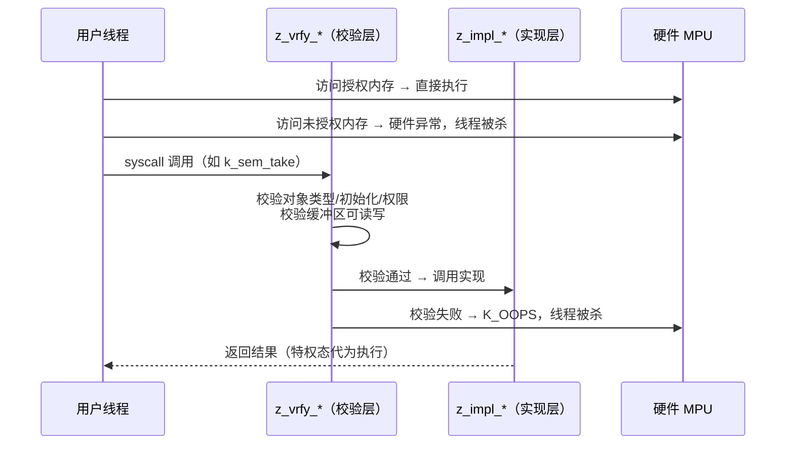

:::note[阅读提示]
本章节涵盖 Zephyr RTOS 的通用技术概念。芯海 EC 平台的具体应用请参考 **开发指南** 与 **移植指南**。
:::

:::info[学习目标]
通过本章学习，你将掌握：

- `CONFIG_USERSPACE` 的威胁模型：它保护什么、不保护什么
- 三类内核对象与权限管理：`k_object_access_grant`、静态授权与动态对象
- 创建用户线程的两种方式：`K_USER` 选项与 `k_thread_user_mode_enter`
- `__syscall` 系统调用机制：`z_impl_`/`z_vrfy_` 命名约定、验证宏、TOCTOU 防护
- 评估 EC 固件何时值得启用用户态、何时不必
:::

## 概述

到目前为止本教程的所有代码都运行在**特权态（supervisor mode）**：任何线程都能访问任何内存、直接调用任何内核 API。Zephyr 的用户态机制（`CONFIG_USERSPACE`）引入了第二执行级别——**用户态（user mode）**线程被内核视为不可信代码：

- 只能访问被明确授权的内核对象与内存域
- 所有内核操作必须经过系统调用（syscall）入口，参数由内核逐一校验
- 越权访问触发硬件异常，线程被杀死而**不是**拖垮整个系统

对 EC 固件而言，这提供了一种此前没有的能力：让**解析不可信输入**（主机命令、外部协议报文）或**扩展逻辑**运行在隔离沙箱中，解析代码的野指针不再可能踩坏电源状态机。这是一把需要付代价的利器——本章讲清机制，也讲清取舍。

## 1. 用户态架构概览

### 1.1 威胁模型：保护什么、不保护什么

启用 `CONFIG_USERSPACE` 后，Zephyr 官方给出的边界如下：

| 维度 | 保护 | 不保护 |
|------|------|--------|
| 内存 | 用户线程访问未授权内存 → 硬件异常 | 内核自身/工具链/构建过程的缺陷 |
| 内核对象 | 用户线程把对象指针当普通内存解引用 → 不可能（对象不透明） | 特权态代码的错误 |
| 栈 | 用户栈溢出被硬件检测并安全处理 | **线程 CPU 饿死型 DoS**（一个用户线程吃满 CPU 仍可能拖慢系统） |
| 驱动 | 用户线程只能通过校验过的 syscall 驱动设备 | 特权态配置的内存域错误 |

关键约束（来自官方文档，直接影响架构设计）：

1. **所有内核对象、线程栈、驱动实例必须在编译期定义**；动态场景走预定义对象池
2. **syscall 校验有开销**——Zephyr 常规路径几乎不做参数检查，用户态的每层检查都是真实的性能与 footprint 代价
3. **同时活跃线程数有编译期上限**，超限后用户线程创建失败
4. **MPU 系统上线程只能访问自己的栈缓冲区**——不要假设 MMU 式的栈共享行为

### 1.2 三类内核对象

用户态视角下，内核对象分三类，权限规则一致但用途不同：

| 类别 | 例子 | 对用户线程的可视性 |
|------|------|------------------|
| 核心内核对象 | `k_sem`、`k_mutex`、`k_msgq`、`k_thread` | 完全不透明——用户线程拿到地址也不能解引用，只能经 syscall 使用 |
| 线程栈 | `K_THREAD_STACK_DEFINE` 定义的栈区域 | 只能作为创建线程的栈使用 |
| 驱动实例 | `const struct device` | 只能通过驱动 API（经校验）访问，防止"拿 UART 对象调 I2C" |

权限本质是**每对象一个按线程索引的位图**（大小由 `CONFIG_MAX_THREAD_BYTES` 决定），并且权限同时充当**引用计数**——持有权限即持有引用，对象引用归零后动态对象自动回收。

### 1.3 执行路径：特权态与用户态之间



用户线程回到特权态只有两条路：内核定义的系统调用、中断处理程序。

## 2. 内核对象与权限管理

### 2.1 默认不可访问与授权 API

新创建的用户线程**默认只有自己线程对象的权限**。其他对象必须显式授权：

```c
#include <zephyr/kernel.h>

static K_SEM_DEFINE(ready_sem, 0, 1);   /* 静态定义 = 编译期初始化 */

static void grant_worker(struct k_thread *t)
{
    /* 在特权态（如主线程或创建者线程）中执行授权 */
    k_object_access_grant(&ready_sem, t);
    k_object_access_grant(&some_device, t);   /* 驱动实例同样按对象授权 */
}
```

完整授权 API（均为 v3.7 签名）：

| API | 签名 | 语义 |
|-----|------|------|
| `k_object_access_grant` | `void (const void *object, struct k_thread *thread)` | 授予单对象权限；调用者必须持有所需权限 |
| `k_object_access_revoke` | `void (const void *object, struct k_thread *thread)` | 撤销权限（同时减引用计数） |
| `k_object_access_all_grant` | `void (const void *object)` | 设为 public——**所有**线程可用，且不可撤销，慎用于不可信代码场景 |
| `k_object_release` | `void (const void *object)` | 用户态线程主动放弃自己的权限 |
| `k_object_is_valid` | `bool (const void *obj, enum k_objects otype)` | 特权态校验对象类型 |

### 2.2 静态授权：编译期定好权限

对象与线程都在编译期定义时，授权也可以在编译期完成，省去运行时代码：

```c
/* 声明静态线程时一并声明其需要的对象——K_THREAD_ACCESS_GRANT */
K_THREAD_ACCESS_GRANT(parser_tid, &ready_sem, &host_cmd_msgq);

/* 创建线程时让它继承创建者的全部权限（除父线程对象本身） */
k_thread_create(&parser_thread, parser_stack, PARSER_STACK_SIZE,
                parser_entry, NULL, NULL, NULL,
                PARSER_PRIO, K_USER | K_INHERIT_PERMS, K_NO_WAIT);
```

`K_INHERIT_PERMS`（无 `CONFIG_USERSPACE` 时无副作用）是最省心的静态授权方式：让**创建者线程持有恰好所需的权限集**，子线程继承之。权限审计因此可以聚焦创建者。

### 2.3 初始化状态：未初始化的对象用不了

多数内核对象操作要求对象处于"已初始化"状态（`K_OBJ_FLAG_INITIALIZED`）：

- 通过 `K_SEM_DEFINE` 等静态宏定义的对象，编译期即初始化 ✅
- 驱动实例在其 init 函数于启动期执行后即算已初始化 ✅
- 嵌在更大结构体里、用私有初始化器（如 `Z_SEM_INITIALIZER`）定义的对象，需要特权态调用 `k_object_init(&my_struct.sem)` 补初始化标记

遗漏初始化是最常见的 userspace 启动失败原因：报错形态是 syscall 校验失败杀线程，而不是普通的内核断言。

### 2.4 动态对象：受限的运行时创建

编译期定义是硬约束，但受控的运行时创建可以通过对象池实现（`CONFIG_DYNAMIC_OBJECTS`）：

```c
/* 从调用线程的资源池中分配一个未初始化的信号量对象 */
struct k_sem *dyn_sem = k_object_alloc(K_OBJ_SEM);
if (dyn_sem == NULL) {
    return -ENOMEM;           /* 池耗尽：返回错误，而不是 K_OOPS */
}

/* 栈对象大小可变，须用 alloc_size */
void *stack_obj = k_object_alloc_size(K_OBJ_THREAD_STACK_ELEMENT, stack_size);
```

动态对象来自**线程资源池（resource pool）**，用 `k_object_free()` 显式回收，或在引用计数归零时自动回收。动态对象仍然"未初始化"，分配后照样要调用对应 `*_init`。

## 3. 创建用户线程

### 3.1 K_USER 选项

```c
#include <zephyr/kernel.h>

#define PARSER_STACK_SIZE 2048

K_THREAD_STACK_DEFINE(parser_stack, PARSER_STACK_SIZE);
static struct k_thread parser_thread;

static void parser_entry(void *p1, void *p2, void *p3)
{
    /* 此处已在用户态：只能访问被授权的对象与内存域 */
    while (1) {
        parse_host_command();
    }
}

void start_parser(void)
{
    k_thread_create(&parser_thread, parser_stack, PARSER_STACK_SIZE,
                    parser_entry, NULL, NULL, NULL,
                    PARSER_PRIO, K_USER, K_NO_WAIT);

    /* 或创建后统一授权 */
    k_object_access_grant(&host_cmd_msgq, &parser_thread);
}
```

`k_thread_create` 的完整签名（v3.7）：

```c
k_tid_t k_thread_create(struct k_thread *new_thread, k_thread_stack_t *stack,
                        size_t stack_size, k_thread_entry_t entry, void *p1,
                        void *p2, void *p3, int prio, uint32_t options,
                        k_timeout_t delay);
```

其中 `options` 中的用户态相关位：

| 选项 | 含义 |
|------|------|
| `K_USER` | 线程在用户态运行，受隔离限制 |
| `K_INHERIT_PERMS` | 继承创建者的全部对象权限（除父线程对象） |

:::warning[栈大小必须用 K_THREAD_STACK_SIZEOF]
传给 `k_thread_create` 的 `stack_size` 必须是栈定义宏的原值或 `K_THREAD_STACK_SIZEOF(stack)` 的结果——用户态栈区域包含 MPU 保护与对齐开销，直接用 `sizeof(stack)` 是未定义行为。
:::

### 3.2 k_thread_user_mode_enter：单程降权

对"初始化后不再需要特权"的线程（如 main 的后半段），可以就地永久降权：

```c
FUNC_NORETURN void k_thread_user_mode_enter(k_thread_entry_t entry,
                                            void *p1, void *p2, void *p3);
```

语义要点：

- **永久**：不会回到特权态（函数不返回）
- 调用后**当前栈缓冲区内容被擦除**，TLS 重置——降权前的栈上数据不可依赖
- 内存域成员资格、资源池、对象权限、优先级与选项**全部保留**

### 3.3 用户栈的硬件前提

`CONFIG_USERSPACE` 依赖 MPU/MMU 硬件栈保护：用户线程越界访问自己的栈会触发硬件故障（fault），而不是静默踩内存。这是用户态提供"栈溢出安全处理"承诺的基础。

:::warning[平台支持核查]
用户态需要平台支持硬件线程栈保护。`qemu_x86` 完整支持 `CONFIG_USERSPACE`，适合本章全部实操；`native_sim` 官方文档未承诺用户态支持（POSIX 架构无 MPU 栈保护语义），**不要在 native_sim 上验证用户态功能**。实际 EC 芯片是否支持，以该 SoC 的 Zephyr 支持页为准。
:::

## 4. 系统调用

### 4.1 __syscall：声明即生成

内核 API 面向用户态的入口通过 `__syscall` 属性声明（必须是原型的**第一个**元素）：

```c
/* include/zephyr/kernel.h 中的真实形态 */
__syscall int k_sem_take(struct k_sem *sem, k_timeout_t timeout);
```

构建系统扫描 `__syscall` 原型（`scripts/build/parse_syscalls.py`），自动生成：

- 用户态调用的**内联包装**：无 userspace 时直接调用实现（零开销），有 userspace 时陷入内核
- syscall ID 与分发表（`include/generated/zephyr/syscall_list.h`）
- 参数**封送（marshalling）**代码（`include/generated/<api>_mrsh.c`）

应用自定义的 syscall 头文件需在 CMake 中注册（`zephyr_syscall_header(...)`），并在头文件尾部包含生成的同名头（如 `#include <zephyr/syscalls/mydrv.h>`）。

### 4.2 z_impl_ 与 z_vrfy_：实现与校验分离

```c
/* 实现函数：真正干活，内核态 */
int z_impl_mydrv_set_threshold(struct mydrv_data *data, int threshold)
{
    data->threshold = threshold;
    return 0;
}

/* 校验函数：用户态调用先过这里 */
int z_vrfy_mydrv_set_threshold(struct mydrv_data *data, int threshold)
{
    /* 校验对象：类型正确 + 已初始化 + 调用线程有权限 */
    K_SYSCALL_OBJ(data, K_OBJ_MYDRV_DATA);
    K_SYSCALL_VERIFY_MSG(threshold >= 0 && threshold <= 100,
                         "threshold %d out of range", threshold);

    return z_impl_mydrv_set_threshold(data, threshold);
}
```

校验工具箱（均位于 `include/zephyr/internal/syscall_handler.h`）：

| 宏 | 用途 |
|----|------|
| `K_SYSCALL_OBJ(ptr, type)` | 校验对象：类型匹配 + 已初始化 + 有权限 |
| `K_SYSCALL_OBJ_INIT(ptr, type)` | 同上，但允许未初始化（用于 init 类 API） |
| `K_SYSCALL_OBJ_NEVER_INIT(ptr, type)` | 要求未初始化（仅 `k_thread_create` 类场景） |
| `K_SYSCALL_MEMORY_READ(ptr, size)` / `K_SYSCALL_MEMORY_WRITE` | 校验缓冲区权限 |
| `K_SYSCALL_MEMORY_ARRAY_READ(ptr, nmemb, size)` / `..._WRITE` | 数组版本，内部正确处理乘法溢出 |
| `K_SYSCALL_VERIFY_MSG(cond, fmt, ...)` / `K_SYSCALL_VERIFY` | 通用条件断言 |
| `K_OOPS(expr)` | 校验失败 → 杀死调用线程（kernel oops） |

命名约定：实现函数前缀 `z_impl_`，校验函数前缀 `z_vrfy_`，两者与 syscall 同签名。未编译进内核的 syscall 被调用时路由到 `handler_no_syscall()` → `K_OOPS`。

### 4.3 TOCTOU：校验后的拷贝纪律

校验通过不代表安全：如果校验的是用户内存中的指针，用户线程可能在**校验之后、使用之前**（time-of-check to time-of-use）并发改写指针指向的内容。因此：

```c
int z_vrfy_mydrv_submit(const struct mydrv_req *req)
{
    struct mydrv_req local;

    /* 小结构体：校验可读后，拷贝到（特权态）栈上再使用 */
    K_SYSCALL_MEMORY_READ(req, sizeof(*req));
    k_usermode_from_copy(&local, req, sizeof(*req));

    /* 之后只使用 local，绝不使用用户态指针 */
    return z_impl_mydrv_submit(&local);
}
```

- 小参数：`k_usermode_from_copy()` / `k_usermode_to_copy()` 拷贝进出
- 大缓冲区：仅在受限模式（纯写入不读取、读取后不处理、同步使用）下可直接使用，否则必须拷贝
- 解引用用户态内存的校验函数本身就是攻击面——能用拷贝就用拷贝

### 4.4 应用自定义子系统对象

驱动子系统对象（按 API 指针区分，防止拿 UART 对象调 I2C）在用户态同样走 `K_SYSCALL_DRIVER_OP` / `K_SYSCALL_SPECIFIC_DRIVER` 校验。若要新增自定义内核对象类型，需要：

1. 在 `scripts/build/gen_kobject_list.py` 的 `kobjects`（核心对象）或 `subsystems`（驱动子系统）列表中注册结构体名
2. 提供校验函数

静态对象由构建系统解析 ELF 的 DWARF 信息自动收编进 gperf 完美哈希表，运行时校验是常数时间。

## 5. EC 场景定位与取舍

### 5.1 何时值得启用

| 场景 | 建议隔离对象 | 收益 |
|------|-------------|------|
| 解析不可信主机命令报文 | 报文解析线程（用户态）+ 命令 msgq（授权对象） | 解析器野指针/越界只死解析线程，主控不受伤 |
| 运行第三方/扩展协议处理 | 扩展线程（用户态，最小权限集） | 故障半径收敛到扩展本身 |
| 量产前 fuzzing | 被测解析器跑用户态 | fuzz 崩溃可观测、可复位，不烧坏其余模块 |

### 5.2 何时不启用

- **全可信、代码量小**的固件：syscall 开销与 footprint 纯属负资产
- **内存极度受限**的平台：权限位图 + 对象元数据 + 双实现路径都有成本
- 目标平台**无 MPU/MMU 栈保护**：`CONFIG_USERSPACE` 根本开不了

:::tip[务实的演进路径]
不必一步到位全盘 userspace 化。常见的第一步是只把**一个**解析不可信输入的线程降级到用户态（`K_USER` + 最小权限集），其余架构不动。权限集用 `K_INHERIT_PERMS` 从一个专职"授权线程"继承，审计时只需审这一个线程。
:::

## 6. 实操任务

以下任务在 `qemu_x86` 上完成（用户态完整支持，无需硬件）。

### 任务 1：跑通官方用户态示例

```bash
west build -b qemu_x86 samples/userspace/hello_world_user -p
west build -t run   # 或 ./build/zephyr/zephyr.elf，Ctrl+A X 退出
```

观察启动日志中用户线程的创建与 syscall 路径。然后：

1. 把示例中的一个用户态线程改为访问未授权对象，确认内核以 oops 杀死该线程、其余系统继续运行
2. 在 prj.conf 中关掉 `CONFIG_USERSPACE` 再编译，对比 footprint（rom/ram 尺寸）

### 任务 2：最小授权模型

构建一个双线程拓扑：特权态的"命令分发线程" + 用户态的"解析线程"，解析线程通过 `K_INHERIT_PERMS` 只获得一个 `k_msgq` 的权限。要求：

1. 解析线程尝试 `k_sem_take` 一个未授权信号量 → 观察被杀
2. 给它补授权后恢复
3. 写一段说明：如果要给解析线程加一个"读当前温度"能力，权限链要动哪几处（对象授权 + syscall 校验）

### 任务 3：TOCTOU 演练

实现 4.3 节的 `mydrv_submit` syscall：先写"校验后直接用用户指针"的版本，再写"拷贝到本地"的版本，并解释第二个版本防住了什么。

## 学习总结

- 用户态把线程视为不可信代码：内存按域授权、内核对象完全不透明、一切内核操作走校验过的 syscall；越权 = 硬件异常 + 线程被杀，系统其余部分存活
- 权限模型：`k_object_access_grant` 运行时授权、`K_THREAD_ACCESS_GRANT`/`K_INHERIT_PERMS` 编译期授权；权限同时是引用计数；对象须处于已初始化状态（静态宏定义即隐式初始化）
- 用户线程创建：`k_thread_create` + `K_USER` 选项，或 `k_thread_user_mode_enter` 单程永久降权（栈内容被擦除）；栈大小必须 `K_THREAD_STACK_SIZEOF`
- 自定义 syscall：`__syscall` 原型 + `z_impl_` 实现 + `z_vrfy_` 校验；校验宏 `K_SYSCALL_OBJ/MEMORY/ARRAY_*`；TOCTOU 防靠 `k_usermode_from_copy` 拷贝
- EC 取舍：解析不可信输入是最佳第一落点；全可信小固件、无 MPU 平台不必启用

## 参考资源

- [Zephyr 3.7 User Mode Overview](https://docs.zephyrproject.org/3.7.0/kernel/usermode/overview.html) —— 威胁模型与约束
- [Zephyr 3.7 Kernel Objects](https://docs.zephyrproject.org/3.7.0/kernel/usermode/kernelobjects.html) —— 对象与权限
- [Zephyr 3.7 System Calls](https://docs.zephyrproject.org/3.7.0/kernel/usermode/syscalls.html) —— syscall 机制
- 上游示例：`samples/userspace/hello_world_user/`、`tests/kernel/mem_protect/userspace/`
