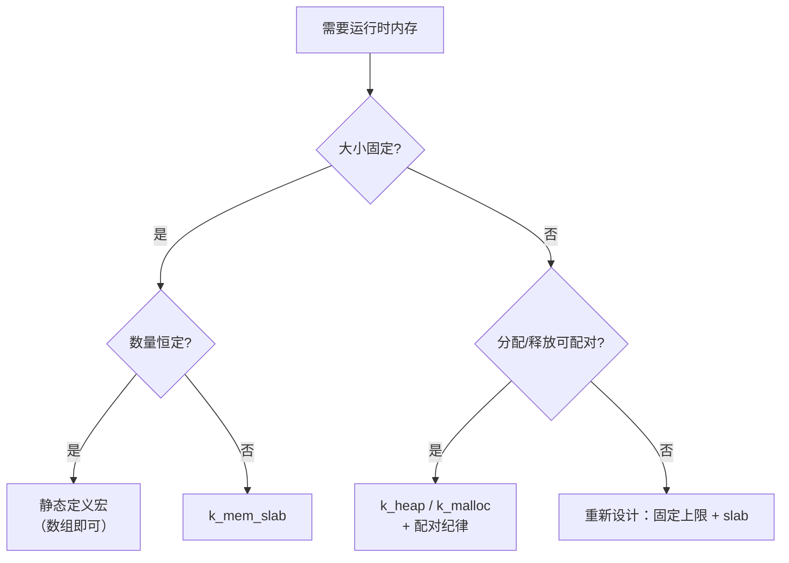

:::note[阅读提示]
本章节涵盖 Zephyr RTOS 的通用技术概念。芯海 EC 平台的具体应用请参考 **开发指南** 与 **移植指南**。
:::

:::info[学习目标]
通过本章学习，你将掌握：

- 内核对象的两种诞生方式：编译期静态定义宏 vs 运行时 `*_init` 函数，以及各自的适用边界
- Zephyr 的回收语义：为什么没有 `deinit`、`k_thread_abort` 不释放资源、动态对象的引用计数回收
- `k_mem_slab` 固定块内存池：定义、分配、释放、运行统计，与防碎片价值
- `k_heap` 通用堆与系统堆 `k_malloc`：用法、代价与约束
- 静态分配 / slab / heap 的选型决策表，以及线程栈尺寸的测量方法
:::

## 概述

嵌入式固件的内存策略比桌面程序苛刻得多：没有虚拟内存兜底、没有 GC、崩溃就是整机重启。Zephyr 把内存分为两个正交问题：

1. **内核对象的生命周期**——信号量、队列、线程这些控制结构在哪里诞生、谁负责回收
2. **数据缓冲区的内存池**——消息块、上下文结构体这类运行时数据从哪块内存来

本章把两个问题一次讲透。先讲对象生命周期（多数对象应该静态定义，回收语义出人意料地"简单"），再讲两个内存池原语 `k_mem_slab` 与 `k_heap`，最后给出决策表。

## 1. 内核对象生命周期

### 1.1 两种诞生方式

| 方式 | 形态 | 时机 | 适用 |
|------|------|------|------|
| **静态定义宏** | `K_SEM_DEFINE(name, initial, limit)` 等 | 编译期初始化，链接进数据段 | **默认首选**：所有权固定、无动态创建需求 |
| **运行时 init** | `k_sem_init(&sem, ...)` / `k_msgq_init(...)` | 启动或对象创建时 | 对象嵌在大结构体里、参数运行时才确定 |

```c
/* 方式一：静态定义——编译期即完成初始化，用户态下自动获得已初始化标记 */
K_SEM_DEFINE(data_ready, 0, 1);
K_MUTEX_DEFINE(state_lock);
static K_FIFO_DEFINE(event_fifo);       /* 私有作用域用 static */

/* 方式二：运行时初始化——对象存储区先有，参数后给 */
static struct k_msgq cmd_msgq;
static char cmd_msgq_buf[8 * sizeof(uint32_t)];

void comm_init(void)
{
    k_msgq_init(&cmd_msgq, cmd_msgq_buf, sizeof(uint32_t), 8);
}
```

静态定义宏的完整族谱（均已在对应章节使用过）：

| 对象 | 静态宏 | 运行时初始化 |
|------|--------|--------------|
| 信号量 | `K_SEM_DEFINE(name, initial, limit)` | `k_sem_init(sem, initial, limit)` |
| 互斥锁 | `K_MUTEX_DEFINE(name)` | `k_mutex_init(mutex)` |
| 消息队列 | `K_MSGQ_DEFINE(name, msg_size, max_msgs, align)` | `k_msgq_init(msgq, buffer, msg_size, max_msgs)` |
| FIFO | `K_FIFO_DEFINE(name)` | `k_fifo_init(fifo)` |
| 事件位 | `K_EVENT_DEFINE(name)` | `k_event_init(event)` |
| 线程 | `K_THREAD_DEFINE(name, stack_size, entry, p1, p2, p3, prio, options, delay)` | `k_thread_create(...)` |
| 工作项 | `K_WORK_DEFINE(work, handler)` / `K_WORK_DELAYABLE_DEFINE(work, handler)` | `k_work_init` / `k_work_init_delayable` |
| 内存 slab | `K_MEM_SLAB_DEFINE(name, block_size, num_blocks, align)` | `k_mem_slab_init(slab, buffer, block_size, num_blocks)` |
| 堆 | `K_HEAP_DEFINE(name, bytes)` | `k_heap_init(h, mem, bytes)` |
| 栈 | `K_THREAD_STACK_DEFINE(sym, size)` | ——（栈没有运行时初始化） |

### 1.2 回收语义：没有 deinit

Zephyr 内核对象**没有 `deinit`/`destroy` API**。这是有意的设计：

- 静态对象的寿命 = 系统寿命，无需回收
- 动态创建的场景（`k_object_alloc`，见 [用户态与内核对象权限](/docs/zephyr-kernel/14_userspace)）靠**权限引用计数**回收——引用归零自动释放，`k_object_free` 显式回收
- 对象"复位"用各自的 API 完成：`k_msgq_purge` 清空队列、`k_sem_reset` 清零计数

:::warning[k_thread_abort 不释放资源]
`k_thread_abort()` 永久停止线程执行，但**不会释放该线程持有的互斥锁、内存块等资源**——清理是调用者的责任。杀一个持锁线程前先想清楚锁谁来解，否则留下一个永久锁死的对象。
:::

实践纪律：

```c
/* ✗ 危险：直接 abort 持锁线程 */
k_thread_abort(worker_tid);          /* state_lock 可能永远锁死 */

/* ✓ 安全：先同步确认线程已退出临界区（线程内不再持锁），再 abort */
k_sem_give(&worker_exit_sem);        /* 通知线程自行退出 */
k_thread_join(&worker_thread, K_SECONDS(2));   /* 等待退出 */
k_thread_abort(&worker_thread);      /* 兜底 */
```

（`k_thread_join` 在 Zephyr 3.7 可用，等待线程终止；替代旧式的手动标志位轮询。）

### 1.3 对象嵌在结构体里：初始化器 + k_object_init

对象嵌入更大的结构体（每个设备实例一份信号量）时，无法使用 `K_SEM_DEFINE` 这类顶层宏。特权态代码可以用私有初始化器 + `k_object_init` 补齐编译期初始化与标记：

```c
struct sensor_ctx {
    struct k_sem data_sem;
    int id;
};

static struct sensor_ctx sensor_0_ctx = {
    .data_sem = Z_SEM_INITIALIZER(sensor_0_ctx.data_sem, 0, 1),
    .id = 0,
};

void sensor_0_init(void)
{
    k_object_init(&sensor_0_ctx.data_sem);   /* 标记为已初始化（用户态场景必需） */
}
```

纯特权态固件可以省略 `k_object_init`（它只影响 userspace 校验），但保留它让代码平滑演进到用户态。

## 2. k_mem_slab：固定块内存池

### 2.1 为什么需要 slab

频繁 `malloc/free` 变长对象会带来两个嵌入式不能容忍的问题：**碎片**（长时间运行后总内存够、连续块不够）与**非确定性**（分配耗时随堆状态变化）。`k_mem_slab` 用"固定大小块 + 预分割内存区"同时消灭两者：

- 分配 = 从空闲链表取一个块，O(1)、恒定耗时
- 块大小恒定 → 永不碎片化
- 支持阻塞等待空闲块（带超时），天然背压

### 2.2 定义、分配与释放

```c
#include <zephyr/kernel.h>

/* 静态定义：块大小、块数、对齐（block_size 必须是 align 的整数倍，
 * align 为 2 的幂）。
 * 注意：K_MEM_SLAB_DEFINE 生成公共作用域符号，不能与 static 同用；
 * 私有作用域用 K_MEM_SLAB_DEFINE_STATIC。 */
K_MEM_SLAB_DEFINE(cmd_slab, sizeof(struct cmd_msg), 16, 4);

void producer_thread(void)
{
    struct cmd_msg *msg;
    int rc;

    rc = k_mem_slab_alloc(&cmd_slab, (void **)&msg, K_MSEC(50));
    switch (rc) {
    case 0:
        msg->type = CMD_SAMPLE;
        fill_cmd(msg);
        k_fifo_put(&cmd_fifo, &msg->node);   /* 连同块一起交出去 */
        break;
    case -ENOMEM:      /* K_NO_WAIT 且无空闲块 */
    case -EAGAIN:      /* 超时仍未获得 */
        drop_counter_inc();
        break;
    default:
        break;
    }
}

void consumer_thread(void)
{
    struct cmd_msg *msg;

    while (k_fifo_get(&cmd_fifo, K_FOREVER) != NULL) {
        process(msg);
        /* 释放：3.7 签名为 void (struct k_mem_slab *slab, void *mem) */
        k_mem_slab_free(&cmd_slab, msg);
    }
}
```

| API | 签名（v3.7） | 语义 |
|-----|--------------|------|
| `k_mem_slab_alloc` | `int (slab, void **mem, k_timeout_t)` | `0`=成功；`-ENOMEM`=无块且 `K_NO_WAIT`；`-EAGAIN`=超时。**ISR 中必须 `K_NO_WAIT`** |
| `k_mem_slab_free` | `void (slab, void *mem)` | 归还块（3.7 起第二参数为 `void *`） |
| `k_mem_slab_init` | `int (slab, void *buffer, size_t block_size, uint32_t num_blocks)` | 运行时初始化，`0`/`-EINVAL` |

### 2.3 运行统计：容量规划的依据

slab 的最大价值是可以**精确测量**——三个查询函数直接对应容量规划三问：

```c
printk("used=%u free=%u peak=%u\n",
       k_mem_slab_num_used_get(&cmd_slab),   /* 当前占用量 → 负载水位 */
       k_mem_slab_num_free_get(&cmd_slab),   /* 剩余量 → 拒绝预算 */
       k_mem_slab_max_used_get(&cmd_slab));  /* 峰值 → 扩容依据 */
```

上线前让系统跑全负载场景，记录 `max_used`，把块数定为 `峰值 × 1.5`（向上取整到 2 的幂通常更好）——这是 slab 池标准容量规划法。

### 2.4 EC 场景

固定块池在 EC 固件中的典型落点：

- **主机命令缓冲池**：命令结构体大小固定，解析线程从 slab 取块
- **传感器采样帧池**：每帧定长，采集线程分配、聚合线程释放
- **上下文对象池**：每个活动会话（如一个 PD 状态机实例）一块，会话结束归还

:::success[slab 使用纪律]
- 块尺寸宁大勿小（向上对齐），用统计验证后收缩——溢出写坏相邻块比浪费 8 字节严重得多
- 谁分配谁释放的纪律要贯穿模块文档；跨模块传递时明确"所有权随消息转移"
- slab + `k_fifo`（块内嵌 `sys_snode_t`/`k_fifo` 节点）是 EC 中最常见的组合拳
:::

## 3. k_heap：通用堆

### 3.1 定义与分配

变长分配的需求存在（如解析出长度未知的报文），`k_heap` 提供"指定内存区域上的通用分配器"：

```c
#include <zephyr/kernel.h>

/* 定义一个 4KB 的私有堆（缓冲区落在 .noinit 段） */
K_HEAP_DEFINE(buf_heap, 4096);

/* 不需要缓存一致性的场景还有 K_HEAP_DEFINE_NOCACHE（落在 __nocache 段） */

void *parse_alloc(size_t len, int *err)
{
    void *p = k_heap_alloc(&buf_heap, len, K_MSEC(20));
    *err = (p == NULL) ? -ENOMEM : 0;    /* 超时/耗尽统一返回 NULL */
    return p;
}
```

| API | 签名（v3.7） | 语义 |
|-----|--------------|------|
| `k_heap_alloc` | `void *(h, size_t bytes, k_timeout_t)` | 成功返回地址，超时/耗尽返回 NULL。**ISR 中必须 `K_NO_WAIT`** |
| `k_heap_free` | `void (h, void *mem)` | `NULL` 合法且无操作 |
| `k_heap_init` | `void (h, void *mem, size_t bytes)` | 运行时初始化（内存区自备） |

### 3.2 系统堆与 k_malloc

不指定堆时，`k_malloc` / `k_calloc` / `k_free` 使用**系统堆**（大小由 `CONFIG_HEAP_MEM_POOL_SIZE` 配置）：

```c
struct report *r = k_malloc(sizeof(*r));
if (r == NULL) {
    return -ENOMEM;
}
k_free(r);                 /* k_free(NULL) 合法 */
```

:::danger[堆分配的三个代价]
1. **碎片**：长期运行的 EC 固件若 malloc/free 模式不齐，碎片会让"总内存够、分配失败"成为真实故障模式
2. **非确定性**：分配耗时随堆状态变化，硬实时路径上的 malloc 是定时炸弹
3. **泄漏难查**：没有引用计数，泄漏表现为"运行几天后分配失败"，复现周期长

**决策原则：固定大小 → slab；启动期一次性分配 → heap/k_malloc；稳定运行后的热路径变长分配 → 想办法变固定（上限截断 + slab）。**
:::

### 3.3 碎片防控实践

不得不在运行期用堆时，用模式而非工具对抗碎片：

- **分配周期配对**：分配/释放发生在同一函数、同一优先级、同一超时窗口内（request-response 模式），碎片无处累积
- **预分配重置**：连接会话开始时一次性分配、结束时一次性归还，会话内部不复用堆
- **低水位告警**：包一层分配器，统计活跃分配数与峰值，超阈值告警——碎片问题在变成故障前就能看见

## 4. 选型决策与栈测量

### 4.1 静态 / slab / heap 决策表

| 需求 | 选择 | 理由 |
|------|------|------|
| 数量固定、寿命 = 系统寿命 | **静态定义宏** | 零开销、零回收问题、链接期即知内存预算 |
| 数量固定、寿命 < 系统寿命、大小固定 | **k_mem_slab** | O(1) 确定性分配、防碎片、可统计 |
| 大小变长、生命周期短且可配对 | **k_heap / k_malloc** | 灵活，配对纪律下可控 |
| 大小变长、寿命不定 | 重新设计为固定上限 + slab | 避免"堆内存悄悄耗尽"型故障 |
| 用户态线程的对象 | 静态定义 + 授权，或 `k_object_alloc`（受限） | 见 [用户态与内核对象权限](/docs/zephyr-kernel/14_userspace) |



### 4.2 栈尺寸测量

内存预算里最容易被拍脑袋的就是线程栈。Zephyr 提供测量工具替代猜测：

```ini
# prj.conf
CONFIG_INIT_STACKS=y            # 启动期把栈填成已知图案（0xAA）
CONFIG_THREAD_STACK_INFO=y      # 保留每线程栈信息
```

```c
#include <zephyr/kernel.h>

void print_stack_usage(const struct k_thread *t, const char *name)
{
    size_t unused;

    if (k_thread_stack_space_get(t, &unused) == 0) {
        size_t size = t->stack_info.size;
        printk("%s: used %u / %u (%u%%)\n", name,
               size - unused, size, ((size - unused) * 100U) / size);
    }
}
```

注意：该函数扫描图案计算**高水位**，只在线程真正运行过之后读数才有意义；开发期全功能开启，量产时按 footprint 需要关闭。配合栈溢出防护（硬件 MPU 栈保护，见 [用户态与内核对象权限](/docs/zephyr-kernel/14_userspace)）构成完整的栈安全闭环：**测量定尺寸，MPU 兜越界**。

### 4.3 内存预算实践

- **链接期就预算化**：静态对象与 slab 都落在确定段（`K_HEAP_DEFINE` 的缓冲区进 `.noinit`），`west build` 后的 ram/rom report 即完整预算
- **.noinit 的取舍**：`K_HEAP_DEFINE`/`K_MEM_SLAB_DEFINE` 缓冲区常放 noinit 段省启动清零时间，代价是复位后内容不保证——不要放需要复位保持语义的数据
- **给 slab/heap 留余量时同步考虑 ISR 触发场景**：ISR 只能 `K_NO_WAIT` 分配，峰值并发下 ISR 分配失败率直接取决于余量

## 5. 实操任务

以下任务在 `native_sim` 上完成，无需硬件。

### 任务 1：slab 高水位测量

按 2.2–2.3 节实现"生产者 → `k_fifo` → 消费者"的 slab 消息流，8 个块：

1. 让消费者处理速度慢于生产者，观察 `-ENOMEM`/`-EAGAIN` 分支与 `k_mem_slab_max_used_get` 触顶
2. 把块数翻倍，确认峰值回落，记录"峰值 → 容量"的计算过程
3. 模拟一次"泄漏"（消费者不释放），确认统计如何定位泄漏侧

### 任务 2：heap vs slab 对比

同一负载分别用 `k_malloc` 与 slab 实现，运行 10 万次分配-释放循环：

1. 对比总耗时（确定性差异）
2. 交叉释放（乱序 free）后再分配最大块，验证 heap 的碎片行为
3. 写三行结论：什么时候 heap 可以接受

### 任务 3：栈测量

创建三个不同深度的线程（递归深度 0/16/64 层），开启 `CONFIG_INIT_STACKS` + `CONFIG_THREAD_STACK_INFO`，用 `k_thread_stack_space_get` 打印各自用量，并按 4.2 节公式给出三个栈的最终推荐尺寸。

## 学习总结

- 内核对象默认静态定义（编译期初始化）；运行时 `*_init` 用于嵌入结构体或参数后定的场景；没有 deinit——回收靠"寿命=系统寿命"或动态对象引用计数
- `k_thread_abort` 不释放线程持有的资源，先 join 再 abort；动态对象的回收规则见用户态章节
- `k_mem_slab`：固定块 O(1) 分配、永不碎片化、可阻塞可统计（`num_used`/`num_free`/`max_used`），ISR 只能 `K_NO_WAIT`；3.7 的 `k_mem_slab_free(slab, void *mem)`
- `k_heap`/`k_malloc`：变长但带碎片与非确定性代价；分配-释放配对纪律是使用 heap 的前提
- 决策：恒定数量 → 静态；固定块 → slab；变长且可配对 → heap；变长且不可配对 → 重新设计
- 栈尺寸靠测量：`CONFIG_INIT_STACKS` + `CONFIG_THREAD_STACK_INFO` + `k_thread_stack_space_get` 的高水位读数

## 参考资源

- [Zephyr 3.7 Memory Slab API](https://docs.zephyrproject.org/3.7.0/doxygen/html/group__mem__slab__apis.html) —— k_mem_slab 完整 API
- [Zephyr 3.7 Heap API](https://docs.zephyrproject.org/3.7.0/doxygen/html/group__heap__apis.html) —— k_heap 与 k_malloc
- [Zephyr 3.7 Threads](https://docs.zephyrproject.org/3.7.0/kernel/services/threads/index.html) —— k_thread_stack_space_get 与栈信息
- [Zephyr 3.7 User Mode Kernel Objects](https://docs.zephyrproject.org/3.7.0/kernel/usermode/kernelobjects.html) —— 动态对象与引用计数
