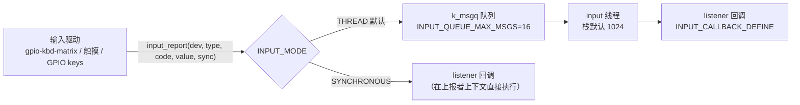

:::note[阅读提示]
本章节涵盖 Zephyr RTOS 的通用技术概念。芯海 EC 平台的具体应用请参考 **开发指南** 与 **移植指南**；EC 键盘矩阵的自研扫描算法（去抖、鬼键）见 **键盘输入模块**。
:::

:::info[学习目标]
通过本章学习，你将掌握：

- input 子系统的事件模型：`struct input_event` 的 type/code/value 三元组与 `INPUT_EV_*` 事件码体系
- `input_report` / `input_report_key` / `_abs` / `_rel` 的上报语义与返回值
- 消费侧 `INPUT_CALLBACK_DEFINE` 的注册方式与回调执行上下文（THREAD/SYNCHRONOUS 两种模式）
- 上游键盘矩阵体系：`kbd-matrix-common` 属性族、`gpio-kbd-matrix` 绑定、SoC 专用矩阵驱动（含 ITE/NPCX/XEC）
- kscan 遗留 API 的真实形态（`kscan_config`）与 `zephyr,kscan-input` 适配桥的**方向**（input→kscan）
- 用 `input report` shell 命令**无硬件注入输入事件**，做回归测试
:::

## 概述

键盘是 EC 的第一外设，但 Zephyr 对输入的处理远不止键盘：触摸屏、旋转编码器、模拟摇杆、电容按键都走同一条事件通道。input 子系统（v3.4 引入，`@since 3.4`）的目标是**统一输入事件面**：驱动侧只管上报"发生了什么"（type/code/value），消费侧只管订阅自己关心的事件——两侧解耦，中间的调度（同步还是异步、哪个线程执行回调）由子系统配置决定。

与 EC 自研键盘框架的关系：本手册 [键盘输入模块](/docs/development/modules/04_keyboard_input) 讲的是**自研扫描算法**（矩阵扫描、去抖、鬼键检测的原理与实现）。本章讲的是 **Zephyr 上游的对应体系**——上游在 `drivers/input/` 里有完整的矩阵键盘公共核心（含去抖与鬼键掩码），以及 ITE / NPCX / XEC 这些 EC 友商芯片的专用矩阵驱动。两条路线怎么选，见 §8。

## 1. 数据流链路



两条模式线（`subsys/input/Kconfig`，v3.7.0 核实）：

- **`INPUT_MODE_THREAD`（默认）**：事件入 `k_msgq`（深度 `INPUT_QUEUE_MAX_MSGS`，默认 16），由专用 input 线程（栈 `INPUT_THREAD_STACK_SIZE` 默认 1024，优先级默认最低应用级）顺序分发。上报者（驱动）不被回调阻塞——**推荐**，驱动 ISR 里上报也不会拖长中断
- **`INPUT_MODE_SYNCHRONOUS`**：回调在**上报者上下文**直接执行，零延迟但回调必须短小（ISR 里上报 = 回调跑在 ISR 里）

入队失败（队列满）时 `input_report` 返回负值——事件会**丢**，高频事件源要关注返回值或调大队列。

## 2. 事件模型

### 2.1 input_event 结构

```c
struct input_event {
	const struct device *dev;   /* 产生事件的设备，可为 NULL */
	uint8_t sync;               /* sync 标志：一组事件的结束标记 */
	uint8_t type;               /* INPUT_EV_* 事件大类 */
	uint16_t code;              /* INPUT_KEY_/BTN_/ABS_/REL_/MSC_* 具体事件 */
	int32_t value;              /* 事件值 */
};
```

事件码沿用 Linux input 体系（`zephyr/dt-bindings/input/input-event-codes.h`）：

| type | code 族 | value 语义 | EC 例子 |
|------|---------|-----------|---------|
| `INPUT_EV_KEY` | `INPUT_KEY_A`、`INPUT_BTN_TOUCH`… | 按下 1 / 释放 0 | 键盘按键、电源键 |
| `INPUT_EV_ABS` | `INPUT_ABS_X/Y/Z`… | 绝对坐标 | 触摸板位置 |
| `INPUT_EV_REL` | `INPUT_REL_X/Y/WHEEL`… | 相对位移 | 旋转编码器增量 |
| `INPUT_EV_MSC` | `INPUT_MSC_SCAN`… | 杂项原始值 | 扫描码透传 |

`sync` 的约定：一次物理动作常产生多个事件（如触摸的 X、Y、按下），**最后一个事件带 `sync=1`** 表示"这组齐了，可以处理"。消费侧据此攒组，避免处理半组状态。

### 2.2 上报侧 API

```c
int input_report(const struct device *dev,
		 uint8_t type, uint16_t code, int32_t value, bool sync,
		 k_timeout_t timeout);

/* 三个语义化包装（v3.7.0 核实） */
input_report_key(dev, INPUT_KEY_POWER, 1, true, K_FOREVER);  /* value 归一为 0/1 */
input_report_abs(dev, INPUT_ABS_X, x, false, K_FOREVER);
input_report_rel(dev, INPUT_REL_WHEEL, 1, true, K_FOREVER);
```

- `timeout` 只在 THREAD 模式有意义——它是入队超时（`k_msgq_put` 的 timeout）；SYNCHRONOUS 模式忽略
- 返回 0 = 事件已处理（同步执行完 / 异步入队成功）；负值 = THREAD 模式入队失败
- `dev` 传 `NULL` 合法（事件不带来源设备，listener 只能全收）

## 3. 消费侧：listener 回调

注册用 `INPUT_CALLBACK_DEFINE`（**注意 v3.7.0 的宏名**，不是 listener 系列）：

```c
#include <zephyr/input/input.h>
#include <zephyr/dt-bindings/input/input-event-codes.h>

static void my_input_cb(struct input_event *evt)
{
	if (evt->type == INPUT_EV_KEY && evt->code == INPUT_KEY_POWER) {
		power_button_action(evt->value);
	}
}

/* dev 非 NULL：只收该设备的事件；NULL：收全部 */
INPUT_CALLBACK_DEFINE(NULL, my_input_cb);
```

要点：

- 回调签名固定为 `void (*)(struct input_event *evt)`；宏展开是一个 `STRUCT_SECTION_ITERABLE`（[链接期注册](/docs/zephyr-kernel/16_linker_and_memory_layout) §3）——**静态注册，无需 init 调用**
- `dev` 非 NULL 时只收匹配设备的事件，实现"某驱动的事件只给某模块"的点对点分发
- THREAD 模式下回调跑在 input 线程——可以做 I/O 但要控制时长（栈 1024 默认值，长回调加 `INPUT_THREAD_STACK_SIZE`）

## 4. 上游键盘矩阵体系（EC 核心）

### 4.1 分层结构

v3.7.0 的矩阵键盘在 **`drivers/input/`**（不是 drivers/kscan）：

```text
dts/bindings/input/
  kbd-matrix-common.yaml      公共属性基类（无 compatible）
  gpio-kbd-matrix.yaml        通用 GPIO 矩阵绑定
  ite,it8xxx2-kbd.yaml        ITE EC 芯片专用矩阵
  nuvoton,npcx-kbd.yaml       Nuvoton EC 芯片专用矩阵
  microchip,xec-kbd.yaml      Microchip XEC 专用矩阵
  input-keymap.yaml           键位映射表

drivers/input/
  input_kbd_matrix.c          公共扫描核心（去抖/鬼键/轮询/中断）
  input_gpio_kbd_matrix.c     gpio-kbd-matrix 的驱动实现
  input_ite_it8xxx2_kbd.c     ← 友商 ITE 同体系
  input_npcx_kbd.c            ← 友商 NPCX 同体系
```

公共核心 `input_kbd_matrix` 把扫描调度、去抖、鬼键检查做成框架，芯片驱动只实现两个函数：`drive_column`（驱动列线）与 `read_row`（读行线）——**芯片差异收敛在两个函数里**，这正是"换芯片不改算法"的上游版本。

### 4.2 关键属性（kbd-matrix-common）

| 属性 | 默认 | 含义 |
|------|------|------|
| `row-size` / `col-size` | — | 矩阵尺寸（gpio-kbd-matrix 由 gpios 数量决定） |
| `debounce-down-ms` / `debounce-up-ms` | 10 / 20 | 按下/释放去抖时间 |
| `poll-period-ms` | 5 | 轮询周期 |
| `poll-timeout-ms` | 100 | 键盘空闲后回到低功耗前的轮询时长 |
| `settle-time-us` | 50 | 驱动列线后的电平稳定等待 |
| `actual-key-mask` / `no-ghostkey-check` | — | [鬼键检测](/docs/development/modules/04_keyboard_input)：真实按键掩码 / 关闭检查 |

`gpio-kbd-matrix` 的 `idle-mode` 三选一：`interrupt`（默认，行线中断唤醒）、`poll`（常轮询）、`scan`——interrupt 模式要求行 GPIO 支持中断，空闲时系统可以睡到有键按下（对照[功耗优化](/docs/best-practices/02_power_optimization)）。

### 4.3 应用消费链

矩阵驱动（如 gpio-kbd-matrix）内部把按键事件以 `INPUT_EV_KEY`（keymap 转换后）或位置事件上报——应用侧照 §3 写 listener 即可，不需要知道底下是 GPIO 矩阵还是 ITE 专用控制器。键位映射用 `input-keymap`（`CONFIG_INPUT_KEYMAP`，DT 里放"行列 → key code"表，芯片无关）。

## 5. kscan：遗留 API 与适配桥

### 5.1 kscan API 真实形态

kscan（Keyboard Scan，`@since 2.1`）是 input 子系统之前的键盘接口，v3.7.0 仍在维护：

```c
typedef void (*kscan_callback_t)(const struct device *dev, uint32_t row,
				 uint32_t column, bool pressed);

__syscall int kscan_config(const struct device *dev, kscan_callback_t callback);
__syscall int kscan_enable_callback(const struct device *dev);
__syscall int kscan_disable_callback(const struct device *dev);
```

注意：配置函数名是 **`kscan_config`**（不是 configure）；回调直接给 `(row, column, pressed)`，扫描码解码留给应用。

### 5.2 适配桥的方向（与直觉相反）

v3.7.0 的 `drivers/kscan/` 目录**没有任何硬件 kscan 驱动**——只剩一个文件 `kscan_input.c`（`zephyr,kscan-input`，绑定在 `dts/bindings/kscan/`）。它是 **input→kscan 的适配桥**：

```text
input 设备（父节点）
  └─ kscan_input 节点（child，compatible: zephyr,kscan-input）
       把父设备的 INPUT_ABS_X/ABS_Y/BTN_TOUCH + sync 事件
       转成 kscan 回调 callback(dev, row, column, pressed)
```

也就是说：**新硬件驱动都在 input 侧**（§4），kscan 只是为了让老式应用（`chosen { zephyr,keyboard-scan = &kscan_input; }`）能消费新驱动的事件。方向是"新事件面 → 老接口"，**不是**"老 kscan 驱动上报给 input"。

**EC 迁移含义**：存量 EC 代码若用 kscan 回调形态，DT 里挂一个 `zephyr,kscan-input` 子节点即可吃上游矩阵驱动的事件，应用代码不动；新代码一律走 `INPUT_CALLBACK_DEFINE`。

## 6. 测试钩子：无硬件注入输入事件

input 子系统的 shell（`CONFIG_INPUT_SHELL`，实现在 `subsys/input/input_utils.c`）提供三个命令，其中第一个是**回归测试利器**：

```text
uart:~$ input report 1 116 1 1     # 模拟按下电源键（type=1 EV_KEY, code=116 KEY_POWER, value=1, sync=1）
uart:~$ input dump on              # 打开事件转储（需 CONFIG_INPUT_EVENT_DUMP）
uart:~$ input kbd_matrix_state_dump <device>   # 实时打印矩阵键盘状态（需 CONFIG_INPUT_SHELL_KBD_MATRIX_STATE）
```

`input report` 走的就是真实分发路径（`input_report(NULL, ...)`）——listener 收到的与真实按键完全一致。这意味着**没有键盘硬件也能测整个键盘处理链路**：脚本化 `input report` 序列 + 断言系统行为，就是键盘回归测试（测试框架接入见 [测试框架](/docs/development/debug/06_test_framework)；配合 [实时性测量](/docs/zephyr-kernel/17_measurement_and_tracing) §8 的预算表可做"注入→上报"延迟回归）。

## 7. 实操任务

`native_sim` 上免硬件完成（input 子系统不需要真实输入硬件）：

```bash
# 1. 构建 input_dump 官方样例
west build -b native_sim samples/subsys/input/input_dump -p
west build -t run

# 2. 交互串口里注入事件（shell）
uart:~$ input report 1 30 1 1    # 按下（KEY_A=30, value=1, sync）
uart:~$ input report 1 30 0 1    # 释放
# 观察 CONFIG_INPUT_EVENT_DUMP 打出的事件序列与 sync 标记

# 3. 写一个 §3 的 listener（INPUT_CALLBACK_DEFINE），统计 power 键按下次数，
#    用 input report 注入验证；再把模式切到 SYNCHRONOUS 对比回调上下文
```

**进阶**：在一块带矩阵键盘的真实 EC 板上（或 qemu 参考 `ite,it8xxx2-kbd`/`npcx-kbd` 的 dts）配置 `gpio-kbd-matrix`，用 `input kbd_matrix_state_dump` 观察去抖前后的状态跳变。

## 8. 上游体系 vs 自研框架的选型

| 维度 | 上游 input 体系 | 自研扫描框架（[键盘输入模块](/docs/development/modules/04_keyboard_input)） |
|------|----------------|--------------------------------------------------------------------------|
| 去抖/鬼键 | 公共核心内置（DT 属性可调） | 自己实现，可做到极致定制 |
| 芯片适配 | ITE/NPCX/XEC 驱动现成，换芯片复用 | 每芯片重写 |
| 事件消费 | 统一 listener 面，触摸/编码器同路 | 只服务键盘 |
| 测试 | `input report` 注入即测 | 需要自建注入点 |
| 定制自由度 | 框架约束内 | 完全自由（特殊扫描时序、混合矩阵） |

**建议**：新项目优先评估上游体系（特别是所用芯片已有 `*-kbd` 驱动时——bring-up 成本趋近于 0）；需要非常规扫描策略（如超大矩阵、复用 PD 引脚）时走自研，但**保留 input 事件面的出口**（自研框架的按键结果用 `input_report_key` 上报），消费侧统一，未来随时可切。

## 9. 学习总结

- input 子系统 = 统一输入事件面：`input_report(type, code, value, sync)` 上报 → `INPUT_CALLBACK_DEFINE` 订阅，事件码沿用 Linux input 体系；`sync=1` 标记一组事件的结束
- 默认 **THREAD 模式**（k_msgq + 专用线程，队列 16/栈 1024）；SYNCHRONOUS 模式回调跑在上报者上下文，入队失败会丢事件
- 上游矩阵键盘体系在 `drivers/input/`：`kbd-matrix-common` 属性（去抖/鬼键/轮询）+ `gpio-kbd-matrix` 通用绑定 + ITE/NPCX/XEC 芯片驱动；芯片差异收敛到 `drive_column`/`read_row` 两个函数
- **kscan 是遗留 API**（`kscan_config`，回调给 row/col/pressed）；`zephyr,kscan-input` 是 input→kscan **适配桥**，方向是让老应用消费新驱动——存量 kscan 代码靠它零改动吃上游事件
- `input report` shell 命令走真实分发路径，**无硬件注入事件**是键盘链路回归测试的标准手段
- 选型：芯片有现成 `*-kbd` 驱动优先上游；自研框架保留 `input_report_key` 出口，消费侧统一

## 10. 参考资源

- [include/zephyr/input/input.h（v3.7.0）](https://github.com/zephyrproject-rtos/zephyr/blob/v3.7.0/include/zephyr/input/input.h) —— `input_report` / `INPUT_CALLBACK_DEFINE` 定义
- [subsys/input/Kconfig（v3.7.0）](https://github.com/zephyrproject-rtos/zephyr/blob/v3.7.0/subsys/input/Kconfig) —— 模式选择与队列/线程参数
- [drivers/input/input_kbd_matrix.c（v3.7.0）](https://github.com/zephyrproject-rtos/zephyr/blob/v3.7.0/drivers/input/input_kbd_matrix.c) —— 矩阵扫描公共核心
- [dts/bindings/input/（v3.7.0）](https://github.com/zephyrproject-rtos/zephyr/tree/v3.7.0/dts/bindings/input) —— `gpio-kbd-matrix` 等绑定
- [drivers/kscan/kscan_input.c（v3.7.0）](https://github.com/zephyrproject-rtos/zephyr/blob/v3.7.0/drivers/kscan/kscan_input.c) —— input→kscan 适配桥
- 内部衔接：[键盘输入模块](/docs/development/modules/04_keyboard_input)（自研扫描算法与鬼键原理）、[链接脚本与内存布局](/docs/zephyr-kernel/16_linker_and_memory_layout)（listener 的链接期注册机制）、[异步与消息总线](/docs/zephyr-kernel/13_async_messaging)（THREAD 模式底层的 k_msgq）、[测试框架](/docs/development/debug/06_test_framework)（注入式回归的落位）
